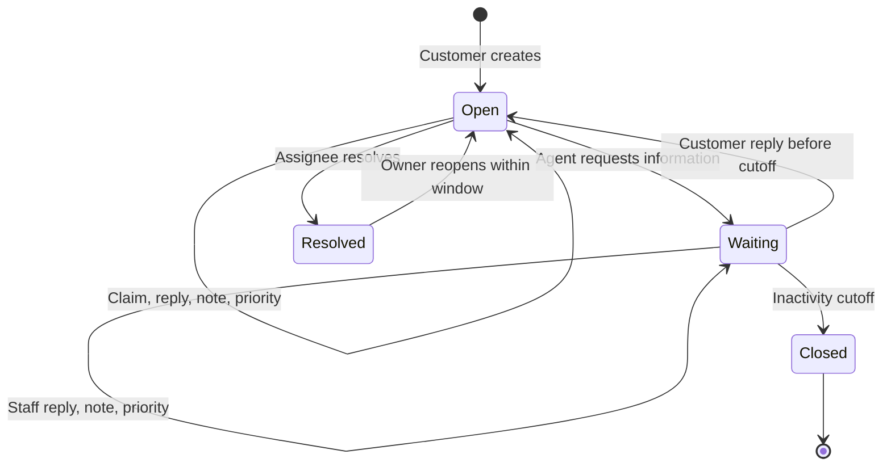

# Architecture

Express serves the compiled Vite site and /api on one origin. Keep route validation and serialization at the HTTP boundary. Ticket services own authorization, state transitions and transactions. A pure business calendar module computes SLA times with an injected clock. PostgreSQL is the source of truth. Prisma handles ordinary queries and parameterized SQL handles locking and conditional claims.

```text
client/src/{auth,tickets,components}
server/src/{auth,tickets,sla,audit,jobs}
server/prisma/{schema.prisma,migrations}
server/test/{unit,integration}
docs/
```

## Lifecycle

Claim is assignment on Open. Resolved means staff marked work done. Closed means inactivity ended the ticket. All writes check actor and state inside a transaction. Missing or inaccessible tickets return 404, wrong roles or non-assignee staff writes return 403, invalid state and dated cutoff conflicts return 409, and invalid inputs return 400.

| Action | Actor and precondition | Result | SLA effect | Audit |
|---|---|---|---|---|
| Create | Customer, valid subject and description | Open, unassigned | Start both clocks | CREATED |
| Claim | Agent, Open and unassigned | Open, assigned | Unchanged | CLAIMED |
| Public reply | Assignee, Open or Waiting | Same | Complete pending first response | PUBLIC_REPLY |
| Private note | Assignee, Open or Waiting | Same | Unchanged | PRIVATE_NOTE with message ID |
| Request information | Assignee, Open, public question required | Waiting | Complete first response if pending, pause resolution, set closure cutoff | PUBLIC_REPLY, WAIT_STARTED |
| Customer reply | Owner, Open or Waiting before cutoff | Open | Resume resolution if waiting | CUSTOMER_REPLY, WAIT_ENDED if applicable |
| Resolve | Assignee, Open, public reply required if first response pending | Resolved | Finalize resolution and pending response | PUBLIC_REPLY if supplied, RESOLVED |
| Auto-close | System, Waiting at or beyond cutoff | Closed | Cancel paused resolution, retain breach | AUTO_CLOSED |
| Reopen | Owner, Resolved before reopen cutoff, explanation required | Open, same assignee | Start new resolution cycle | REOPENED and CUSTOMER_REPLY |
| Change priority | Assignee, Open or Waiting, different priority and reason | Same | Apply SLA budget rules | PRIORITY_CHANGED |
| Report an expired issue | Owner creates a ticket, optional own terminal source link | New Open ticket | Fresh clocks | CREATED with source ID |

An overdue wait is closed transactionally before attempting a customer or agent mutation. Commit closure before returning 409. A due closure takes precedence over writes at the cutoff. Breach events accompany mutations that discover breaches.



## PostgreSQL schema

Use UUID primary keys where specified and timestamptz(3) for every instant. Use UTC instants and database-generated audit recording times, DATE for local holidays, enums for state, role, priority and message/clock kind, and restrictive foreign keys without cascades. No user-facing delete operations. All fields below are required unless marked optional.

| Model | Fields, relationships and constraints | Indexes and validation |
|---|---|---|
| User | id UUID PK, email TEXT UNIQUE, displayName TEXT, passwordHash TEXT, role CUSTOMER or AGENT, createdAt, updatedAt, disabledAt optional | Normalize email before write and enforce lowercase, validate email and bounded display name. Provision demo accounts through seed script |
| Session | id UUID PK, tokenHash BYTEA UNIQUE, userId UUID FK, createdAt, expiresAt, revokedAt optional | Index userId and expiresAt, expiry after creation, 32-byte hash. Runtime can delete sessions for logout/expiry |
| Ticket | id UUID PK, customerId UUID FK, assigneeId UUID FK optional, sourceTicketId UUID self-FK optional, reference TEXT UNIQUE, subject and description TEXT, priority, status, calendarId UUID FK, createdAt, updatedAt, waitingSince, closeDueAt, resolvedAt, closedAt, closeProcessedAt optional | Index (customerId, createdAt, id), (assigneeId, status), (status, closeDueAt), (createdAt, id). Check timestamp fields match state and waiting/resolved/closed require assignee. Service verifies FK roles, ownership of source and bounded subject. Ticket description is stored separately from follow-up messages |
| TicketMessage | id UUID PK, ticketId and authorId UUID FKs, kind CUSTOMER_PUBLIC, AGENT_PUBLIC or INTERNAL, body TEXT, createdAt | Index (ticketId, createdAt, id) and (ticketId, kind, createdAt, id). Validate trimmed 1–4,000 characters, enforce kind by server action and actor |
| SlaClock | id UUID PK, ticketId UUID FK, kind RESPONSE or RESOLUTION, cycle INT, startedAt, activeSince optional, elapsedMs, originalBudgetMs and budgetMs BIGINT, pausedAt and dueAt optional, state RUNNING, PAUSED, COMPLETED or CANCELED, endedAt and firstBreachedAt optional | UNIQUE (ticketId, kind, cycle), index (state, dueAt) and (ticketId, firstBreachedAt), partial unique (ticketId, kind) for active clocks. Check nonnegative budget and elapsed, positive cycle, response uses cycle 1 and status/timestamp consistency. Protect terminal cycles, original budgets and first breach timestamps with a DB trigger |
| HolidayCalendar and Holiday | Calendar id UUID PK, version INT UNIQUE, publishedAt optional. Holiday calendarId UUID FK, date DATE and label TEXT, composite PK (calendarId, date) | Publish shared immutable snapshots. Tickets reference published versions. Operator changes create a new version |
| AuditEvent | id BIGINT sequence-backed PK, ticketId UUID FK, actorId UUID FK optional for system, actorKind USER or SYSTEM, action enum, effectiveAt, recordedAt, optional old/new status, details JSONB | Index (ticketId, id). Require actorId iff USER, validate event-specific allowlisted payload. Private note events carry IDs only. Per-ticket timeline ordered by event ID under ticket serialization |

Treat IDs and role information as application-managed. SQL CHECK constraints enforce row-local invariants. Enforce cross-table role and ticket ownership invariants in transaction services. Preserve ticket messages and clock outcomes. Disable accounts rather than deleting historical actors.

## Transactions and incident controls

- **INC-0291.** Claim with one conditional UPDATE for id, status OPEN and assigneeId IS NULL, returning the updated row. One affected row means success. Zero means inspect existence and return 404 or 409. Insert the claim event in the same transaction. Subsequent agent mutations require the authenticated assignee. Lock the ticket row before checking eligibility, capture the time after obtaining the lock, update ticket, message and clocks, and append audit before commit. Use the same ticket-first lock order in all writers.
- **INC-0304.** Use a separate private-note endpoint with fixed message kind. Customer reads select only public messages with owner scope in SQL and serialize explicit customer fields. No audit endpoints for customers. Exclude note presence, previews, counts, search matches and staff activity timestamps from customer lists and detail. Any future customer export must share the public query and serializer. Keep customer responses uncached and redact message bodies from logs.
- **INC-0318.** Each successful business mutation writes type, actor, timestamps, transition details and related IDs atomically. On failure all writes roll back. Migration owner creates audit table, denies runtime UPDATE, DELETE, TRUNCATE and ownership, and installs rejection triggers for UPDATE/DELETE and TRUNCATE. Runtime gets SELECT and column-scoped INSERT plus required sequence rights. PostgreSQL supplies the recording time and event ID. Revoke inherited/public write grants and schema CREATE privileges. The application can append events and a compromised runtime could append false events. The migration owner, provider and privileged DBA can alter grants or disable triggers. Confirm the host supports role separation in Phase 9 and state any unresolved limit in the submission.

## Authentication and frontend

Seed agents and customers with environment-supplied credentials. Use bcrypt with calibrated cost (start at 12), reject passwords beyond its 72-byte limit, and return generic login failures. Generate cryptographically random 32-byte opaque tokens, store SHA-256 digests with an eight-hour absolute expiry, and send tokens through HttpOnly, Secure in production, SameSite=Lax, host-only cookies. Validate same-origin Origin on browser writes, including login, and require JSON for body-bearing requests. Trust only the known reverse proxy configuration for IP handling. Rate-limit logins by IP and normalized account in the process and use TLS on hosting. Recheck session, expiry and user state per request. Set the session row's revocation timestamp at logout and clear the matching cookie. Phase 3 enforces the configured HTTPS production origin on writes, with same-origin Referer fallback when Origin is absent. The development allowlist covers the configured backend port and Vite on loopback. Rate limits use bounded process-local IP and account counters.

The agent queue defaults to My tickets plus access to Unassigned and All. Include status, priority, assignee, SLA deadline, overdue and historical breach labels. Show summary counts for open, waiting and overdue within the selected queue. Search by subject or exact ticket ID. At narrower widths use stacked rows with visible status and clear focus targets. Ticket detail shows public conversation, a separately styled and labeled staff-note composer, activity/audit, SLA and eligible actions. Use explicit send labels, keyboard navigation, form labels, readable contrast, and live status announcements. Show loading, empty, validation, retry and claim conflict states. On conflict refresh assignment and preserve draft text. Customer UI has login, own ticket list, create, detail, reply and reopen or new-ticket action. Use synthetic data for demonstrations.

## Phase 3 integration boundaries

The routes in `server/src/auth` authenticate and authorize from PostgreSQL sessions. The ticket module uses explicit role-specific Prisma projections, locks tickets before message writes, and stores audit events in the same transaction. Customer-owned Open tickets can accept replies. Waiting customer replies are temporarily rejected because opening the ticket and resuming resolution must be one operation. Staff replies and notes require assignment. The initial ticket description lives on Ticket, and further conversation lives on TicketMessage. Claiming, audit-history reads and full lifecycle actions retain their planned phases. Clock creation and first-response updates will be added inside the existing transactions in Phase 4.

## Phase 4 SLA integration

The pure `server/src/sla` calendar and clock operations use integer milliseconds and explicit time inputs. PostgreSQL keeps both original and current budgets. The completion migration adds the final deadline and on-time flag, covered by the existing terminal immutability trigger. The application batches calendar and clock reads for the selected staff page and evaluates them at one request instant. SQL filters by stored running deadlines and historical breach markers before pagination.

The creation transaction inserts both clocks before writing the audit record. An agent reply completes response under the same ticket lock used for message and audit writes. Backfill uses that lock as well, inserts only missing facts, and leaves previous cycles untouched. Prisma database sessions explicitly use UTC so timestamps retain their intended absolute instant even if the PostgreSQL server defaults to another timezone. The repair migration introduces append-only SLA deadline evidence with a clock foreign key and SELECT-only runtime access. A completed correction is projected at read time without changing any terminal row. Running corrections are committed with the active deadline update, so persistence predicates and clock transitions consume the same value. Phase 5 owns the orchestration for the remaining clock transitions and scheduled reconciliation.

## Lifecycle maintenance and hosting

Start catch-up after database readiness, run periodically while awake (every minute), and invoke bounded catch-up on authenticated reads when due. For detail and mutations reconcile the relevant ticket synchronously. Drain small eligible batches using FOR UPDATE SKIP LOCKED, and recheck Waiting and the cutoff under lock. Apply transition and event in one transaction, recording effective cutoff and actual processing time separately. Use the same approach to record due SLA breaches, with idempotency from persisted state under lock. Cap request work and let the periodic worker drain the backlog. Queue reads may briefly lag a large backlog. Free-tier sleep delays processing and cold starts. Effective times remain deterministic.

Phase 9 verifies a single Render Free web service, free subdomain, Render Free PostgreSQL or verified no-card alternative, role support, eligibility, TLS, quotas, expiry, cold start and the full one-week review window. Free-tier availability is pending verification. Keep a local run path using installed PostgreSQL. No paid fallback.
